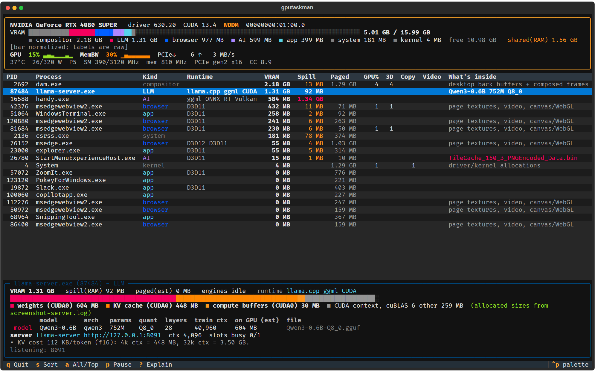
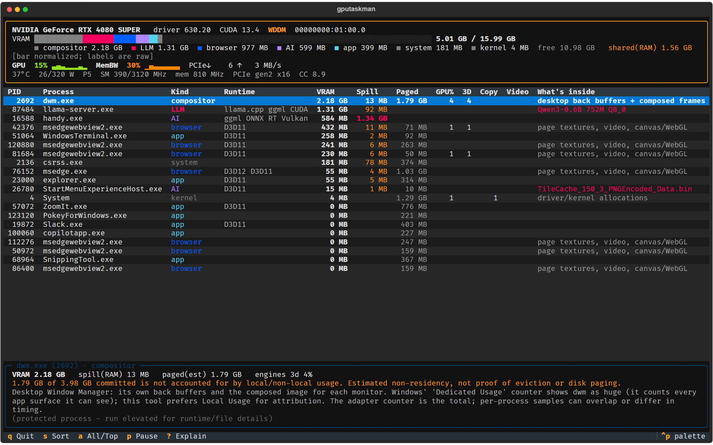
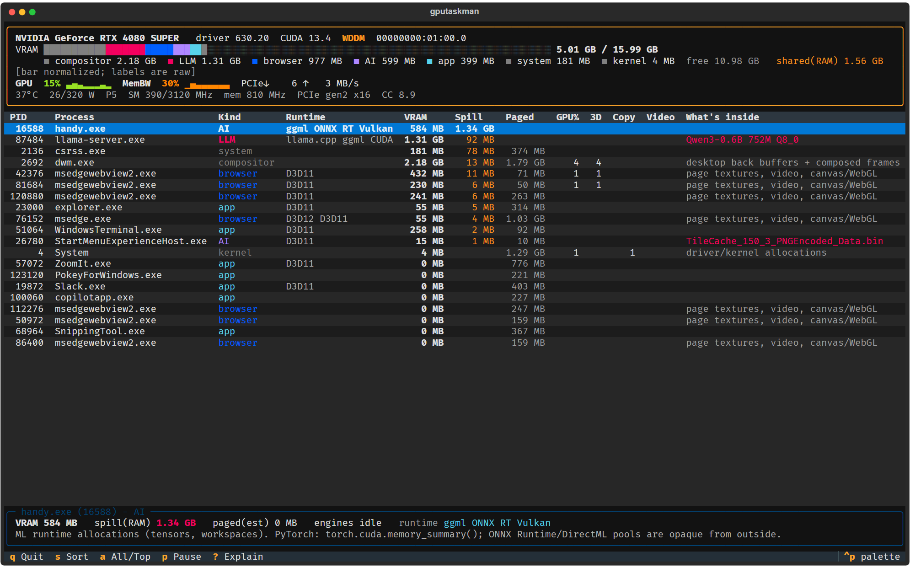
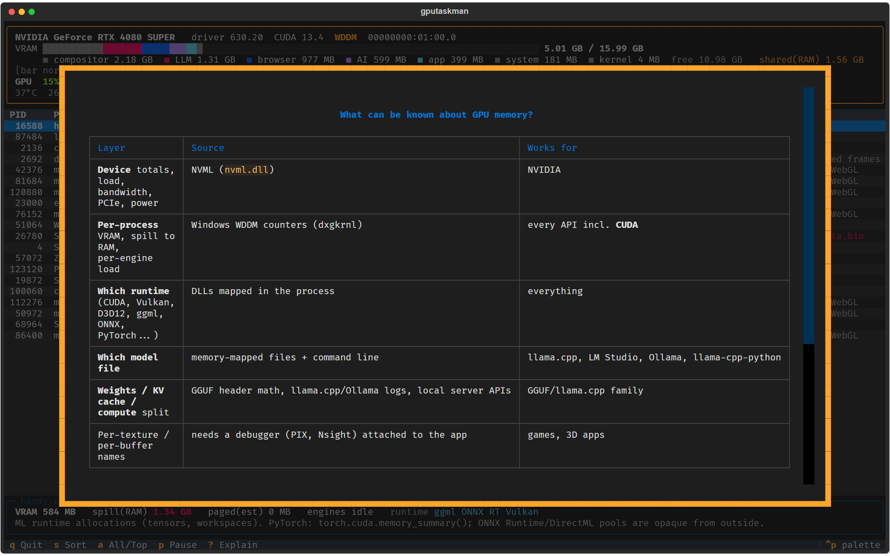

# gputaskman

**An `htop` for what's inside your GPU, not just how full it is.**

Windows + NVIDIA. A terminal UI that connects per-process GPU memory and engine activity
with loaded runtimes, model files, and LLM buffer breakdowns.

Task Manager says "15 GB used." This tries to answer: *by what? Model weights? KV cache?
Your browser? The desktop compositor? And why is so much GPU memory in system RAM?*



> Early, experimental software. Device and process counters are measurements; classifications
> and GGUF-derived breakdowns are estimates. This does not dump VRAM or enumerate a game's textures.

## Clone and run

Use **64-bit Windows 10/11**, an **NVIDIA GPU with a current WDDM driver**, and a terminal
(Windows Terminal is recommended). Development and live workload checks used an RTX 4080 SUPER.

Install [Git for Windows](https://git-scm.com/downloads/win) and
[uv](https://docs.astral.sh/uv/getting-started/installation/) if needed. With WinGet:

```powershell
winget install --id Git.Git --exact
winget install --id astral-sh.uv --exact
```

Open a new PowerShell window so those tools are on `PATH`, then:

```powershell
git clone https://github.com/shanselman/gputaskman.git
cd gputaskman
uv run --locked gputaskman
```

**That's it.** uv obtains the pinned Python version if needed, creates `.venv`, and installs
the locked dependencies. The first run needs internet access. There is no CUDA Toolkit,
Visual Studio, administrator session, API key, or model download required to monitor the GPU.
NVML ships with the NVIDIA driver.

Already have Python 3.11+ and prefer pip?

```powershell
git clone https://github.com/shanselman/gputaskman.git
cd gputaskman
py -m venv .venv
.\.venv\Scripts\python.exe -m pip install .
.\.venv\Scripts\gputaskman.exe
```

No PowerShell activation script or execution-policy change is needed. The pip route resolves
compatible dependencies; the uv route uses the checked-in lockfile.

## What you get

- **Device view:** VRAM usage, GPU activity, memory activity, PCIe traffic, temperature, power and clocks.
- **Process view:** local GPU memory, GPU-accessible system RAM, estimated non-resident commit,
  engine activity, and detected runtimes such as CUDA, Vulkan, Direct3D, ggml and ONNX Runtime.
- **Model inspector:** which model each process holds (LLM, decision, embedding, or speech), how
  it was identified, architecture, quantization, layer count, weights, estimated KV cost, and
  buffer sizes from compatible load logs.
- **Live server hints:** context size, busy slots, throughput when available, and friendly Ollama
  or LM Studio model names.
- **Scriptable output:** one-shot text and JSON, using the same collector as the TUI.

### Screenshots

These are captures of real local workloads through Textual's screenshot renderer, not mock data.
Full filesystem paths and command lines were omitted in the capture copy. Measurements vary
with the workload; the examples are not benchmarks.

**The compositor, without treating all shared surfaces as its private VRAM**



**GPU-accessible system RAM, sorted by the Spill column**



**An explanation of what is measured, inferred, and unavailable**



## Usage

```powershell
uv run --locked gputaskman              # live TUI
uv run --locked gtm                     # shorter alias
uv run --locked gputaskman -i 2         # sample every two seconds
uv run --locked gputaskman --once       # one text snapshot
uv run --locked gputaskman --json       # one JSON snapshot; implies --once
uv run --locked gputaskman --help
```

| Key | Action |
|---|---|
| Up / Down | Select a process and inspect it |
| `s` | Cycle sort: VRAM, GPU%, spill, paged, name |
| `a` | Switch between top and all collected processes |
| `p` | Pause / resume collection |
| `?` | Explain the counters and their limits |
| Escape | Close help |
| `q` | Quit |

A wide terminal (roughly 140 columns or more) makes the full table easier to read.
Model/runtime discovery is throttled, so newly loaded models may take about 15 seconds to appear.

`--gpu N` is available, but **single-NVIDIA-GPU systems are the validated configuration**.
On multi-GPU systems, DXGI and NVML ordering may differ, and buffer logs can span devices;
cross-device attribution is not yet reliable.

## How can it know what's inside?

It combines evidence rather than reading arbitrary GPU memory. Windows' graphics kernel supplies
per-process memory and engine counters, while NVML supplies device metrics. Process DLLs suggest
the runtime, and mapped files or command-line arguments identify candidate models. GGUF metadata
and tensor offsets let it estimate weights and KV-cache costs; compatible runtime logs and local
server APIs add allocated buffer sizes and live state. That can explain a llama.cpp process well,
but a runtime DLL or filename alone does not prove which allocation contains which object.

| Question | Evidence | Confidence / limitation |
|---|---|---|
| How full and busy is the card? | WDDM adapter counters and NVML | Measured; driver support varies by metric |
| Which process uses GPU memory? | WDDM process counters | Measured accounting, not a resource ownership graph |
| Which engines are active? | WDDM engine counters | CUDA can appear on the **3D** engine |
| Which runtime is loaded? | Mapped DLL names | Detection, not proof that every library is doing GPU work |
| Which model file is present? | Mapped files, CLI flags, GGUF magic/header | A file mapping does not prove GPU placement |
| Weights / KV / compute sizes? | Load logs, GGUF math, server state | Log-reported allocations or estimates, not a VRAM scan |
| Which texture, tensor, or kernel is this? | Not available here | Use PIX, Nsight, or runtime-specific instrumentation |

### Why not just `nvidia-smi`?

On GeForce under **WDDM**, Windows manages GPU memory and NVML may report per-process memory as
`N/A`. Windows GPU counters can still attribute memory and activity across Direct3D, Vulkan,
OpenGL, and CUDA. NVML remains useful for device-level readings.

### DWM, Spill, and Paged: read these carefully

**DWM is not everything.** Windows' per-process `Dedicated Usage` includes resources shared
between processes. The same surface may appear against its application, `csrss.exe`, and
`dwm.exe`. Adding those rows double-counts memory. This tool prefers `Local Usage` and
`Non Local Usage`; it falls back to `Dedicated Usage` / `Shared Usage` when the preferred
counters cannot be added. The adapter total remains the reference. See Microsoft's
[GPU accounting explanation](https://devblogs.microsoft.com/directx/gpus-in-the-task-manager/).

In one live sample, DWM's older counter read about 15.3 GiB while `Local Usage` was about
1.4 GiB. The latter reduced the inflated process sum substantially. This is an observed
improvement, not a guarantee that every driver's process counters add up exactly.
When the row sum exceeds the adapter total, the category bar is normalized to fit;
legend values remain raw, and the UI labels the normalization.

**Spill means GPU-accessible system RAM, not proven overflow.** It can include intentionally
allocated or pinned host buffers. Large usage alongside a nearly full GPU can indicate
fallback and slower inference, but the counter alone cannot establish why it was allocated.

**Paged is an estimate:** `max(Total Committed - Local Usage - Non Local Usage, 0)`.
It is not an eviction trace, a pagefile measurement, or proof that Windows just moved
those bytes out of VRAM. The value is also less reliable when fallback counters are in use.

Memory labels currently use `GB` / `MB` for binary units (GiB / MiB). The top-level `MemBW`
reading is NVML's memory-activity percentage, **not measured bandwidth in GB/s**.

## LLM and model support

| Runtime | Current support |
|---|---|
| llama.cpp / llama-server | GGUF discovery, CLI settings, buffer logs, `/props` + `/v1/models` state; exercised live |
| Ollama | Bundled runners, mapped GGUF blobs named from Ollama manifests (`qwen3:14b`), parent `/api/ps`, compatible `server.log`; exercised live |
| LM Studio | Mapped files named from its models folder, `/api/v1/models` (falls back to `/api/v0/models`); tested with fixture responses, not yet end to end |
| Hugging Face cache | `models--org--repo` paths are named `org/repo` |
| Other AI runtimes | DLL detection, plus model files installed with the app (marked *not proven loaded*) |

### How models are identified

Every model row shows its **evidence**, strongest first:

| Evidence | Meaning |
|---|---|
| `api` | The runtime's local API reports the model as loaded |
| `mapped` | Windows shows the file memory-mapped into the process right now |
| `cmdline` | The file was a launch argument (`-m model.gguf`) |
| `installed` | Found in the app's install or data folder; nothing proves it is loaded |

Two sources including `api` or `mapped` show as **confirmed**. Model-store folders only supply a
friendly name. The model *kind* comes from GGUF header keys, not filenames: `decision.type` marks a
decision model (for example [Laya](https://huggingface.co/ggml-org/Laya-GGUF)), `pooling_type`
an embedding model or reranker, `stt.*` a speech model, and a causal model with layers and a
trained context an LLM. llama-server's `/v1/models` `output_modalities` (`text`, `decisions`)
confirms it. Non-causal encoders such as Laya allocate no KV cache, so none is estimated.

Some runtimes (ONNX Runtime, whisper.cpp) read a model into memory and close the file. Windows then
has no record of which file is loaded, so the app's installed models are listed as candidates only.

Identification is designed to stay cheap. Measured on one Windows machine:

| Probe | Cost | Used |
|---|---|---|
| Process list, command line, listening ports | under 1 ms | Once per process / every 5 s |
| Memory-map scan (DLLs + mapped files) | 1-50 ms per process | New processes, a 64 MiB / 10% memory change, or every 2 min; at most 150 ms per refresh |
| GGUF header, model-store manifests | ms, cached | Once per file / every 60 s |
| Local API probes | ms, local only | llama-server `/v1/models` only when its model path changes |
| `psutil.open_files()` | 0.6-2.5 s per process | Never |

With two llama-servers running, a steady refresh costs roughly 15-30 ms of CPU (about 340 ms before
process details were cached).

For log-reported buffer sizes, start your own llama-server with logging enabled:

```powershell
llama-server.exe -m .\model.gguf -ngl 99 -c 8192 --metrics --log-file server.log -lv 4
```

Use a real model you already have. This is an example workload, **not a prerequisite for
running gputaskman**. Verbosity 4 was needed to capture the buffer-size lines in the tested
llama.cpp build. Prefer an absolute log path if the server and monitor use different
working directories.

The collector probes existing local listening ports with GET requests to `/props`, `/slots`,
`/metrics`, `/v1/models`, `/api/ps`, `/api/v1/models`, and `/api/v0/models`. Endpoints may be
absent, disabled, or authenticated; other evidence is still useful. It does not launch `ollama`,
`lms`, or an inference request. Throughput may update only after a request completes.

Ollama's local `server.log` is considered when one Ollama runner is detected. Log formats,
rotation, and stale load blocks can affect attribution, so compare the reported model and
process when interpreting logs. Log sizes describe allocations at load time, not necessarily
which pages remain resident now. An inferred remainder is runtime/unknown overhead, not an
exact measurement of the CUDA context.

Without logs, estimates assume llama.cpp-style placement. Architecture, partial offload,
KV quantization, sliding-window attention, and multiple models in one process can all change
the result. Separate runner processes get separate rows; per-model KV accounting within
one process is not yet supported.

### Spot checks against llama.cpp

The following comparisons used llama.cpp b12061, CUDA 13.4, and an RTX 4080 SUPER.
They validate these examples, not every model architecture or backend.

| Allocation | GGUF estimate | Runtime log |
|---|---|---|
| Qwen3-0.6B Q8_0 GPU weights | 604.15 MiB | 604.15 MiB |
| Qwen3-0.6B KV, 8,192 context, f16 | 896 MiB | 896 MiB |
| Gemma-3-270M GPU weights | 271.81 MiB | 271.86 MiB |
| Gemma-3-270M KV, 4,096 context | 72 MiB upper bound | 49.5 MiB with sliding-window attention |

## Privacy and troubleshooting

The monitor reads local process metadata, compatible model headers, load logs, and local server
responses. It does not dump model weights or send telemetry. **The normal inspector and JSON
output can contain paths, command-line flags, model names, and local ports. Review and redact
captures before posting them publicly.** The screenshot helper omits command lines and full
file paths, but model and process names still require review.

| Symptom | What to check |
|---|---|
| `uv` or `git` is not recognized | Install the prerequisites, then open a new terminal |
| Windows-only message | Run on native Windows, not Linux, macOS, or WSL |
| Empty or incomplete GPU readings | Check the NVIDIA driver and WDDM 2.0+ support in `dxdiag`; use a normal local desktop session |
| Missing DLLs or model details | Protected processes may deny inspection; basic counters can still work without elevation |
| No exact LLM breakdown | Enable compatible buffer logging, or use the GGUF estimate; API/log access is optional |
| The screen looks cramped | Widen the terminal or use `--once` / `--json` |

## Development

```powershell
uv sync --locked
uv run --locked python -m unittest discover -s tests -v
uv build
```

The Windows CI runs hardware-independent checks on Python 3.11 and 3.13. Live GPU behavior
still needs a real Windows GPU; the CI does not pretend to validate that.

To capture native SVG screenshots of your own running workloads:

```powershell
uv run --locked python tools\capture_screenshots.py --output .\captures
```

The checked-in gallery uses PNG renderings of these captures. No models, logs, or executable
downloads are bundled in this repository.

| Module | Responsibility |
|---|---|
| `pdh.py` / `dxgi.py` | Windows counters and adapter enumeration |
| `nvml.py` | NVIDIA device readings |
| `procinfo.py` | Runtime, mapped-file, and process discovery |
| `stores.py` | Friendly names from Ollama, LM Studio, and Hugging Face model stores |
| `gguf.py` | Model metadata, kind, and size estimates |
| `llm.py` | Buffer logs, local server probing, and breakdowns |
| `collector.py` | Shared snapshot collection |
| `app.py` / `report.py` / `cli.py` | TUI, text/JSON, and command-line entry points |

## Next

- Model identity for non-GGUF runtimes (ONNX Runtime, PyTorch, TensorRT) beyond installed candidates.
- Explicit provenance and availability for every counter and estimate.
- Reliable multi-GPU matching and per-device model placement.
- Live throughput deltas, LM Studio validation, and per-model context accounting.
- Optional ETW / runtime instrumentation for allocation lifetime and residency detail.

## License

[MIT](LICENSE).
